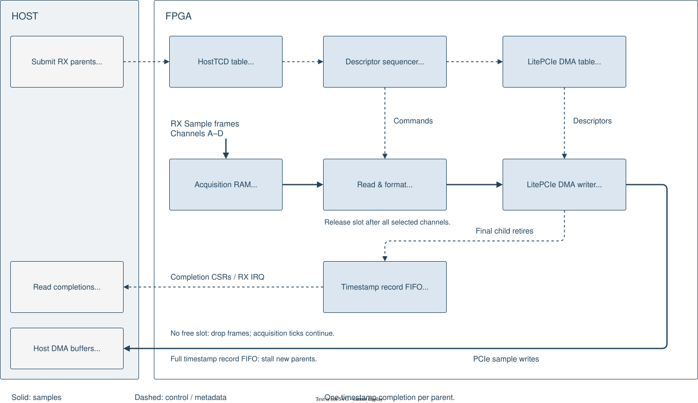
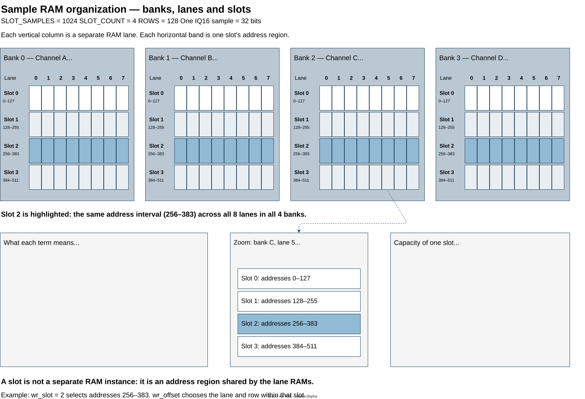

HostTCD RX
==========

HostTCD RX transfers acquired samples into separate host DMA buffers for up to
four channels. Host software submits parent descriptors with destination
addresses and a byte count per channel. The FPGA schedules smaller DMA
transfers, reads the selected channel banks and formats samples as IQ16 or
packed IQ12.

Samples receive a shared acquisition tick before packing or DMA. When the
parent's final DMA child retires, one completion record reports its destination
addresses, sample counts and timestamp continuity. Software reads and pops
these records to associate captured samples with their acquisition time.

   HostTCD RX overview. Solid arrows carry samples; dashed arrows carry control
   and metadata. Sample slots are released after all requested channels have
   been read. Timestamp records are published at final DMA retirement.

HostTCD table and descriptor sequencer
-------------------------------------

The HostTCD table queues up to 16 parent descriptors. Each parent specifies
one DMA destination per selected channel and a common byte count. The
sequencer divides parents into channel blocks and 4 KiB boundary fragments,
then programs the LitePCIe DMA descriptor table. Ordered commands keep sample
readout aligned with those destinations. Program mode consumes queued parents;
loop mode repeats them.

See :ref:`host-tcd-rx-descriptor-table` for host submission and configuration.

Acquisition RAM
---------------

The acquisition path stores simultaneous samples from channels A--D in shared
slots across four RAM banks. Each completed slot carries its first acquisition
tick and gap status. A slot remains owned by the reader until all requested
channels have been read. If no slot is free, incoming frames are dropped while
the acquisition counter continues.

.. _host-tcd-rx-memory-layout:

Memory layout
~~~~~~~~~~~~~

Samples arrive as frames on the 128-bit ``frame_data`` bus. Each valid frame
contains one simultaneous complex sample from each of the four channels
A, B, C and D. Each channel occupies 32 bits: 16-bit I (in-phase) followed
by 16-bit Q (quadrature), with I in the lower bits. Channel A occupies bits
31:0, B occupies 63:32, C occupies 95:64 and D occupies 127:96.

The sample memory is implemented using FPGA **BRAM** (Block Random Access
Memory), the FPGA's dedicated on-chip RAM resources. The following terms
describe the incoming data and its organization in memory:

* **Frame**: one 128-bit input word containing four simultaneous complex
  samples, one from each channel A, B, C and D. 
* **Bank**: the sample memory for one channel. There are four banks, one each
  for channels A, B, C and D. Every accepted frame writes one complex sample
  into each bank at the same time.
* **Lane**: one independent 32-bit-wide RAM array within a bank. Each bank has
  eight lanes. Consecutive samples are written to lanes 0 through 7 in turn;
  reading all eight lanes at the same row returns eight consecutive samples.
  Each 32-bit sample contains 16-bit I (in-phase) and 16-bit Q (quadrature).
* **Slot**: a reusable address region across all lanes of a bank, holding
  ``SLOT_SAMPLES`` samples per channel. The same slot index is used across all
  four banks, so it identifies the same acquisition interval for every channel.
  With the defaults, each slot occupies 128 rows in each lane and holds 1024
  samples per channel. A slot is an address region, not a separate RAM instance.

With the default settings, each bank contains four slots of 1024 IQ16 samples,
giving 16 KiB per bank and 64 KiB overall. Writes distribute consecutive samples
across eight 32-bit lanes. Reading all eight lanes at the same address returns
eight consecutive samples as a 256-bit word.

   Four channel banks, eight lanes per bank and four slot address regions.
   The highlighted slot spans the same address region across all banks and
   lanes; it is not a separate RAM instance.

The write path stores each accepted input frame in all four channel banks.
See :doc:`Writing Samples <host_tcd_rx_write>` for write admission, address
calculation, sample ordering and slot-filling diagrams.

.. toctree::
   :hidden:
   :maxdepth: 1

   Writing Samples <host_tcd_rx_write>

Read & Format
-------------

The read path follows the sequencer's commands to select a completed slot and
channel. It reads eight IQ16 samples in parallel and emits a 256-bit stream,
either preserving IQ16 or packing the upper 12 bits of I and Q as IQ12.
Backpressure pauses readout, and the slot is released after every requested
channel has entered the output FIFO.

See :doc:`Reading Samples <host_tcd_rx_read>` for channel selection, address
calculation, IQ packing and slot release.

.. toctree::
   :hidden:
   :maxdepth: 1

   Reading Samples <host_tcd_rx_read>

Timestamp record FIFO
---------------------

One record is published when a parent's final DMA child retires. It contains
the destination addresses, acquisition ticks, sample counts and gap flags for
all participating channels. The default FIFO holds 256 records; software reads
each through a snapshot and pops it to release capacity. A full reservation
pool stalls new parents rather than discarding completion records.

See :ref:`host-tcd-rx-timestamp-record-fifo` for record fields and the
snapshot/read/pop procedure.

Host software guide
-------------------

See the :doc:`HostTCD RX software guide <host_tcd_software>` when implementing
a host driver or consuming captured samples:

* :ref:`HostTCD RX Descriptor table <host-tcd-rx-descriptor-table>`:
  DMA addresses, channel configuration, block sizes and descriptor submission.
* :ref:`Timestamp record FIFO <host-tcd-rx-timestamp-record-fifo>`:
  record fields, snapshot/read/pop sequence and completion ownership.
* :ref:`Host DMA buffer layout <host-tcd-rx-dma-buffer-layout>`:
  channel destinations, sample ordering and IQ16/IQ12 representation.

.. toctree::
   :hidden:
   :maxdepth: 1

   HostTCD RX software guide <host_tcd_software>

