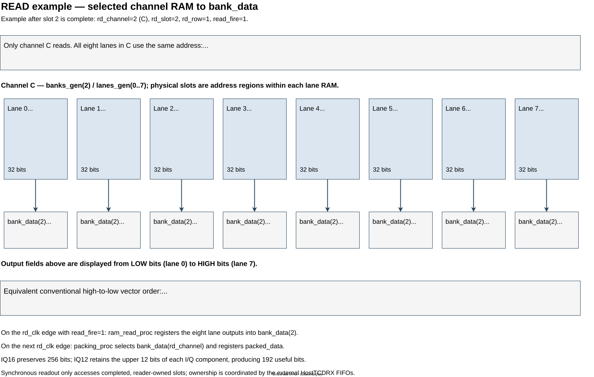

Reading Samples
===============

The read path runs on ``rd_clk`` and retrieves one completed slot from one
selected channel at a time. It packs the samples as IQ16 or IQ12 and emits a
256-bit stream. For bank, lane and slot definitions, see
:ref:`Memory layout <host-tcd-rx-memory-layout>`.

Channel Selection and Read Address
----------------------------------

A command is accepted when ``command_valid`` and ``command_ready`` are both
asserted. ``readout_proc`` latches ``command_slot``, ``command_channel`` and
``command_iq12``, then starts at ``rd_row=0``. All eight lanes of the selected
channel bank use the same RAM address:

.. code-block:: text

   ROWS        = SLOT_SAMPLES / 8
   RAM address = rd_slot * ROWS + rd_row

Each ``read_fire`` retrieves eight consecutive IQ16 samples and advances
``rd_row`` until the final row. For ``rd_slot=2`` and ``rd_row=1`` with the default geometry,
address 257 returns sample positions 8--15 from that slot. Other channel banks
are not read.

   Read example after slot completion: ``rd_channel=2``, ``rd_slot=2``,
   ``rd_row=1``. All eight lanes of channel C read address 257 in parallel.

IQ Packing and Output
---------------------

``ram_read_proc`` registers the lane outputs in ``bank_data``. On the next
``rd_clk`` edge, ``packing_proc`` selects the channel and registers its packed
samples. IQ16 preserves all 256 bits; IQ12 keeps bits 15:4 of each I and Q
component, producing 192 useful bits per RAM read. The reservoir combines
successive packed reads into complete 256-bit output words, accepted when
``source_valid`` and ``source_ready`` are both asserted.

Slot Ownership and Backpressure
--------------------------------

The scheduler retains each completed-slot descriptor while reading every
requested channel. It returns the slot through the ``released_slots``
asynchronous FIFO only after all requested channel data has been accepted into
the output FIFO.
RAM is never overwritten while owned by the reader. Stalls propagate from DMA
through the output FIFO, formatter and synchronous-read capacity tracker.
The tracker reserves room for read results already in flight.

Read reservations are registered in 64-bit units, removing the combinational
path from DMA backpressure through capacity arithmetic to the RAM read enable.
The formatter holds four DMA words, allowing one IQ16 output beat per processing
clock once output starts and while the sink remains ready. IQ12 appends packed
data at fixed 64-bit boundaries rather than using a bit-addressed barrel shifter.

RX version 2 aggregates slot metadata into one completion per HostTCD parent
execution, across all requested channels.
