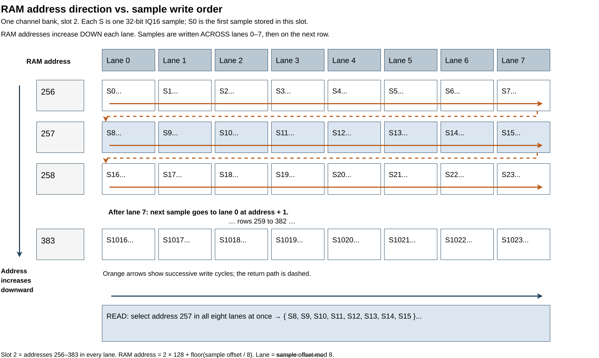
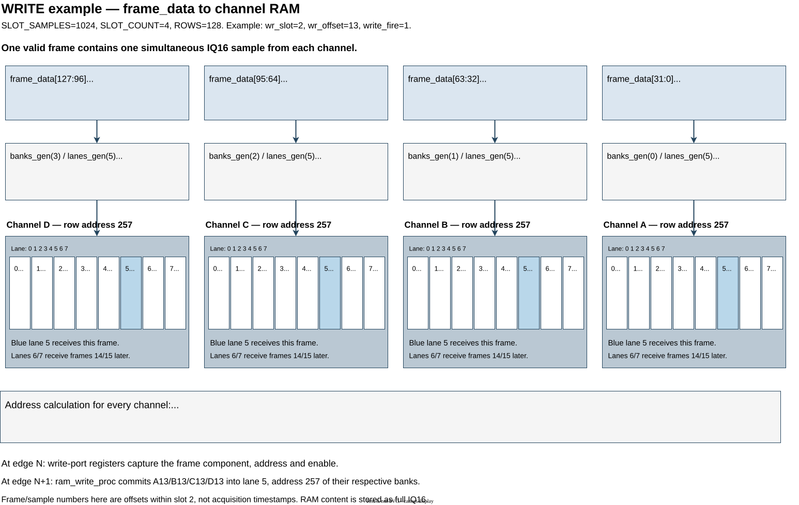
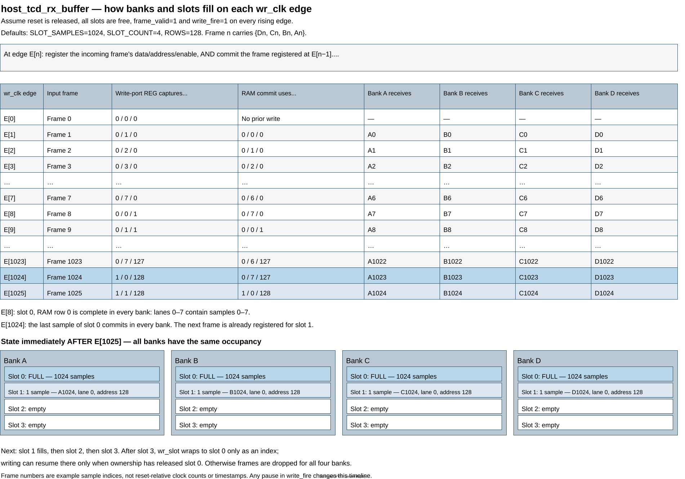

Writing Samples
===============

The write path stores each accepted four-channel IQ16 frame in sample RAM on
``wr_clk``. For bank, lane and slot definitions, see :doc:`Memory Layout <README>`.

Write Admission
---------------

``write_fire`` accepts a frame when capture is enabled, ``frame_valid`` is high
and ``wr_flush`` is low. A new slot must be free, with room to publish its
completion descriptor. Once reserved, the slot receives the same acquisition
interval in all four banks.

Write Address Calculation
-------------------------

``wr_slot`` selects the slot and ``wr_offset`` selects the sample position
within it. All banks use the same lane and address:

.. code-block:: text

   ROWS        = SLOT_SAMPLES / 8
   lane        = wr_offset mod 8
   RAM address = wr_slot * ROWS + wr_offset / 8

Division is integer division. The address selects a 32-bit word within one
lane, not a byte. With ``SLOT_SAMPLES=1024``, each slot occupies 128 rows.

In the diagram below, addresses increase downward. Successive writes move
across lanes 0--7 before advancing to the next row. Each lane therefore receives
one write for every eight accepted frames.

   Orange arrows show sample write order within one channel's slot.

For ``wr_slot=2`` and ``wr_offset=13``, the calculation gives:

.. code-block:: text

   lane        = 13 mod 8 = 5
   RAM address = 2 * 128 + 13 / 8 = 257

The next diagram follows that frame from ``frame_data`` into RAM. Each bank
receives its own 32-bit channel sample at lane 5, address 257. Samples 8--12
already occupy lanes 0--4 at this address; samples 14 and 15 will fill lanes 6
and 7 on subsequent accepted frames.

   One frame writes A13, B13, C13 and D13 into their respective banks together.
   Sample numbers are offsets within the slot, not acquisition timestamps.

Write Timing and Slot Advancement
--------------------------------

``ram_write_pipeline_proc`` first captures ``wr_data_r``, ``wr_addr_r`` and
``wr_en_r``. On the next rising edge, ``ram_write_proc`` commits the sample.
Thus, with continuous input, one frame is registered while the previous frame
is written to RAM. Advancing the write position does not change the pending
write's registered address.

Each accepted frame increments ``wr_offset``. After ``SLOT_SAMPLES`` frames,
it returns to zero and ``wr_slot`` advances, wrapping after the final slot.
Invalid or dropped frames do not advance this position. The timeline below
shows the first slot's final sample committing while the next slot's first
sample is registered; all four banks follow the same progression.

   Continuous accepted frames, including the one-clock write pipeline and
   the slot 0 to slot 1 transition.

Slot Completion and Overflow
----------------------------

The first stored frame captures the slot's acquisition tick. The final frame
raises ``slot_valid`` with ``slot_index``, ``slot_tick`` and ``slot_gap``;
these remain available until ``slot_ready`` accepts the descriptor. The final
RAM write commits one clock after frame acceptance. The external ownership
FIFO's clock crossing prevents readout from seeing uncommitted data.

The writer can reuse a slot only after readout releases it. The AFE cannot be
paused: if a frame cannot be accepted, all four channel samples are dropped.
The acquisition counter still advances on every valid input frame, so the next
stored slot carries its actual first tick and a gap flag. The wrapper exposes
the dropped-frame count through the ``dropped`` CSR, with synchronization delay.
