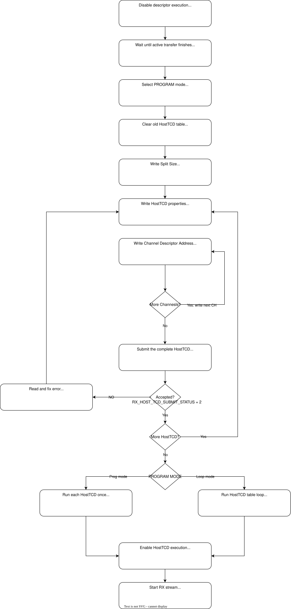
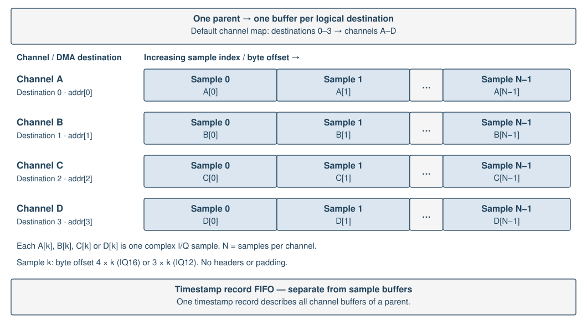

HostTCD RX software guide
========================

HostTCD receives samples into separate host DMA buffers for channels A--D.
Each parent descriptor specifies the channel count, one DMA address per channel,
and the byte count per channel. One timestamp record describes the whole parent.

.. _host-tcd-rx-descriptor-table:

HostTCD RX Descriptor table
---------------------------

Software fills one parent at a time through the CSR staging window. For each
logical channel, select its index, write the DMA address high and low words,
then strobe ``ADDRESS_WRITE``. After staging all channels and the common byte
count, strobe ``SUBMIT``. The FPGA validates and copies the addresses before
making the complete parent visible to the DMA sequencer. Wait for acceptance
before changing staging registers; a successful submission clears the address
initialization mask, so every parent needs its addresses written again.

   HostTCD RX descriptor table and channel DMA destinations.

The following algorithm assumes program mode, available table capacity and
matching RX format, channel map and split size. ``dma_addr`` contains
driver-provided DMA addresses, not application pointers. Use ordered register
accesses and the generated CSR addresses for the loaded bitstream.
``wait_for_clear()`` polls the specified bits and aborts the operation on timeout.

.. code-block:: c
   :caption: Algorithm: fill and submit one HostTCD RX parent descriptor
   :name: host-tcd-rx-fill-descriptor

   wait_for_clear(CSR_RX_HOST_TCD_SUBMIT_STATUS_ADDR, 1, timeout_ms);
   write32(CSR_RX_HOST_TCD_CHANNEL_COUNT_ADDR, channel_count);
   write32(CSR_RX_HOST_TCD_BYTES_PER_CHANNEL_ADDR, bytes_per_channel);
   write32(CSR_RX_HOST_TCD_FLAGS_ADDR, 2); /* Disable early-last termination. */

   for (unsigned i = 0; i < channel_count; ++i) {
       write32(CSR_RX_HOST_TCD_ADDRESS_INDEX_ADDR, i);
       write32(CSR_RX_HOST_TCD_ADDRESS_HIGH_ADDR, (uint32_t)(dma_addr[i] >> 32));
       write32(CSR_RX_HOST_TCD_ADDRESS_LOW_ADDR, (uint32_t)dma_addr[i]);
       write32(CSR_RX_HOST_TCD_ADDRESS_WRITE_ADDR, 1);
   }

   write32(CSR_RX_HOST_TCD_SUBMIT_ADDR, 1);
   wait_for_clear(CSR_RX_HOST_TCD_SUBMIT_STATUS_ADDR, 1, timeout_ms);
   uint32_t status = read32(CSR_RX_HOST_TCD_SUBMIT_STATUS_ADDR);

   if (status & 4) {
       /* Submission rejected: inspect errors, correct and retry. */
   } else if (status & 2) {
       /* Parent queued; DMA completion and buffer release are still pending. */
   }

.. _host-tcd-rx-timestamp-record-fifo:

Timestamp record FIFO
---------------------

RX path publishes one timestamp record when the final native DMA child of
a parent retires, across all requested channels. The default FIFO holds 256
records, each containing 24 32-bit words (96 bytes). Use the loaded bitstream's
generated CSR map for register addresses with the ``CSR_LIMETOP_RXTX_TOP_RX_PATH_``
prefix. Below, ``CSR_..._`` abbreviates this prefix.

Reading entries
~~~~~~~~~~~~~~~

Read the oldest completed parent through the snapshot registers. Poll
``CSR_..._METADATA_LEVEL``, or check it after an RX interrupt.
``CSR_..._METADATA_RESERVED`` includes
unfinished parents as well as unread completions; it is not the readable count.
``wait_for_set()`` polls the specified bits and aborts the operation on timeout.

.. code-block:: c

   while (read32(CSR_..._METADATA_LEVEL) != 0) {
       uint32_t words[24];

       write32(CSR_..._SNAPSHOT, 1);
       wait_for_set(CSR_..._SNAPSHOT_VALID, 1, timeout_ms);

       for (unsigned i = 0; i < 24; ++i) {
           words[i] = read32(CSR_..._RECORD_WORD0 + 4 * i);
       }

       write32(CSR_..._POP, 1);
       process_record(words); /* Process the local copy. */
   }

Use ordered device register accesses. Writing one to ``CSR_..._SNAPSHOT`` latches the
FIFO head into ``CSR_..._RECORD_WORD0`` through ``CSR_..._RECORD_WORD23``; a request
with no available head captures nothing. Wait for ``CSR_..._SNAPSHOT_VALID`` before copying all
24 words. The snapshot stays stable while new completions arrive. Reading a
word does not advance the FIFO, and there is no random entry index.

After copying, write one to ``CSR_..._POP`` to remove that entry, clear
``CSR_..._SNAPSHOT_VALID`` and release one reservation. Pop without a valid snapshot does nothing. Take
a new snapshot for each entry and use a single consumer for the entire sequence.
If entries are not popped, reservations reach capacity and stall new parents;
incoming samples can then be dropped when acquisition RAM fills. Do not pop
independently while ``HostTCDStream`` owns the stream.

Record fields
~~~~~~~~~~~~~

Word indices start at zero. All 64-bit fields store the low word first;
reconstruct them as ``uint64(low) | (uint64(high) << 32)``.

.. list-table:: Timestamp record fields
   :header-rows: 1
   :widths: 12 23 65

   * - Word(s)
     - Field
     - Description
   * - 0
     - ``epoch``
     - Software stream generation, configured while flushed; identifies the session, not a time value.
   * - 1
     - ``parent_sequence``
     - Parent execution sequence modulo 2^32; advances for repeated loop executions even when addresses repeat.
   * - 2
     - ``flags``
     - Bit 8: IQ12 format (otherwise IQ16); bit 16: valid record; bit 17: gap before parent; bit 18: internal gap; bit 19: timestamp discontinuity without an acquisition gap flag.
   * - 3
     - ``channel_map``
     - Two bits per logical destination; destination ``i`` uses physical channel ``(words[3] >> (2*i)) & 3``, where 0--3 mean A--D.
   * - 4
     - ``channel_count``
     - Number of logical destinations, from 1 to 4.
   * - 5
     - ``physical_channel_mask``
     - Bits 0--3 identify participating physical channels A--D.
   * - 6--13
     - ``dma_base_addresses``
     - Four 64-bit destination addresses in logical order. Destination ``i`` uses low word ``6 + 2*i`` and high word ``7 + 2*i``; unused addresses are zero. These are DMA addresses, not application virtual addresses or descriptor staging addresses.
   * - 14--15
     - ``first_tick``
     - Acquisition tick of the first sample in the parent.
   * - 16--17
     - ``last_block_tick``
     - Acquisition tick of the first sample in the parent's final block, not its final sample.
   * - 18
     - ``samples_per_channel``
     - Total complex samples in each destination buffer.
   * - 19
     - ``bytes_per_channel``
     - Total payload bytes in each destination buffer.
   * - 20
     - ``block_count``
     - Acquisition blocks per channel; a block normally holds 1024 complex samples.
   * - 21
     - ``contiguous_samples``
     - Length of the initial contiguous sample interval per channel.
   * - 22
     - ``first_gap_offset``
     - Sample index of the first internal discontinuity, or ``0xffffffff`` when absent.
   * - 23
     - ``reserved``
     - Zero.

The acquisition counter advances on every valid input frame, including dropped
frames, and all channels share a frame's tick. It resets on acquisition-domain
reset, not ordinary stop/start or buffer flush. Ticks are sample frames, not UTC
or host arrival times. For ``0 <= k < contiguous_samples``, sample ``k`` in every
destination has timestamp ``(first_tick + k) mod 2^64``. Divide tick differences
by the actual sample rate to obtain seconds.

A gap before the parent does not invalidate its contiguous prefix. An internal
gap limits reconstruction to that prefix; this summary cannot reconstruct all
later timestamps. Reject records with flag bit 19 set. Validate the epoch,
sequence, addresses, counts and flags before delivering samples. Apply the
driver's DMA ordering and cache synchronization before reading sample buffers.
Popping metadata releases table capacity; buffer reuse still requires consumer
release and separate ownership tracking.

Obtain register addresses from the loaded bitstream's generated ``csr.csv``.
For BAR0 byte offsets, subtract the LiteX CSR base ``0xf0000000`` from the
addresses listed there.

.. _host-tcd-rx-dma-buffer-layout:

Host DMA buffer layout
----------------------

Sample layout in memory
~~~~~~~~~~~~~~~~~~~~~~~

Each selected channel has a separate DMA buffer containing consecutive complex
samples, indexed 0 through ``N - 1``. With the default channel map, ``addr[0]``
points to channel A, ``addr[1]`` to B, and so on. Other channel maps change
this assignment.

* IQ16: four bytes per sample, signed I16 followed by Q16, little-endian.
* IQ12: three bytes per sample, I in bits 11:0 and Q in bits 23:12,
  least-significant byte first. Each component retains its upper 12 acquired bits.

Sample ``k`` starts at byte offset ``4*k`` for IQ16 or ``3*k`` for IQ12.
There are no headers, timestamps or padding between samples.

   Each row is one channel buffer. Indices are relative to the parent buffer,
   not acquisition timestamps.

Transfer split size
~~~~~~~~~~~~~~~~~~~

``split_size`` controls how many bytes the FPGA schedules for one channel
before switching to the next. For this RX path it must equal 1024 samples:

* IQ16: ``split_size = 4096`` bytes.
* IQ12: ``split_size = 3072`` bytes.

``bytes_per_channel`` is the total buffer length and must be a multiple of
``split_size``. Splitting affects transfer scheduling; samples remain consecutive
in each buffer. PCIe fragments do not add headers or padding.

Buffer ownership
~~~~~~~~~~~~~~~~

Match each Timestamp record FIFO entry to its buffers using the epoch, parent
sequence and DMA addresses. Synchronize DMA memory before CPU access. Reuse a
buffer only after DMA completion and consumer release; popping a timestamp
record alone does not release it.
