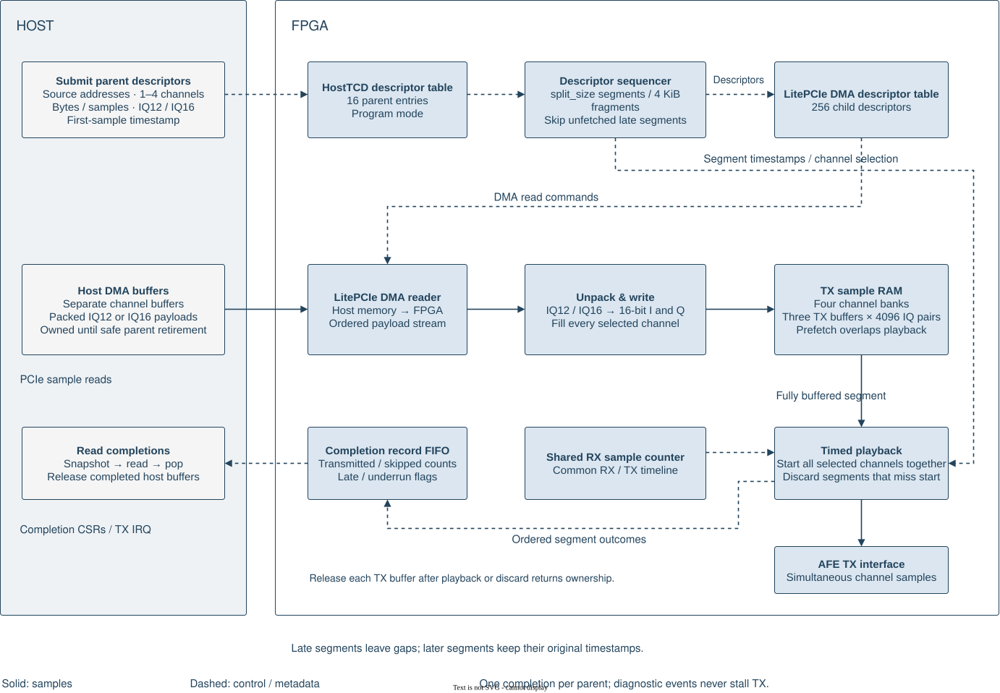
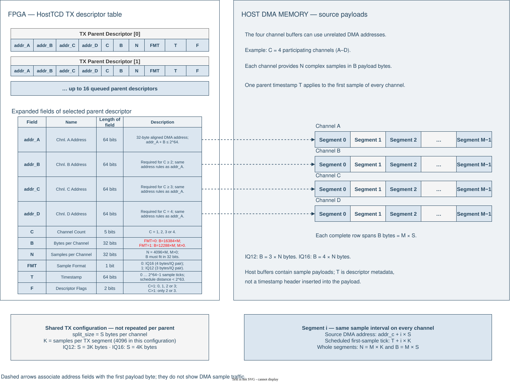
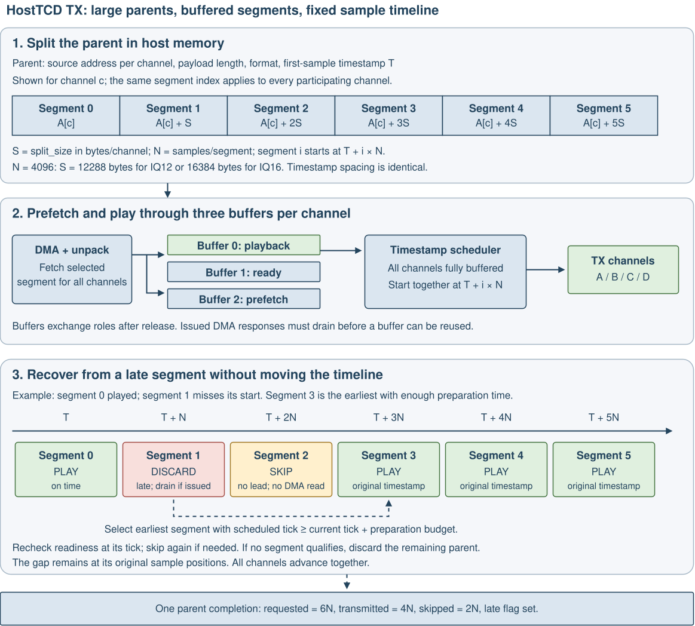

HostTCD TX
==========

HostTCD TX transfers samples from separate host DMA buffers for up to four
channels into the FPGA for timestamped playback. Host software submits parent
descriptors with source addresses, a byte count per channel, the sample format
and the timestamp of the first sample. The FPGA schedules smaller DMA reads,
unpacks IQ16 or packed IQ12 payloads and stores the samples in channel RAM.

.. _hosttcd-terminology:

Terminology and abbreviations
-----------------------------

.. list-table:: HostTCD terminology
   :header-rows: 1
   :widths: 25 75

   * - Term
     - Meaning
   * - HostTCD
     - Host-submitted parent descriptors executed by the FPGA DMA sequencer.
   * - Parent descriptor
     - One host submission covering selected channels, their DMA addresses and
       a common payload length. TX also specifies the first-sample timestamp.
   * - DMA child descriptor
     - One smaller native LitePCIe DMA transfer generated from a parent
       descriptor. It targets one channel and respects PCIe page boundaries.
   * - TX segment
     - A fixed-size sample interval within a TX parent descriptor. Its payload
       is ``split_size`` bytes per channel and fits one TX buffer per channel.
       A segment can require multiple DMA child descriptors.
   * - TX buffer
     - A reusable FPGA sample-memory region holding one TX segment for one
       channel. The same buffer index is used across participating channels.
       Hardware interfaces may call this region a slot.
   * - Completion record
     - One record per retired parent descriptor. TX records describe transmitted/skipped
       samples and errors.
   * - Complex sample / IQ pair
     - One in-phase (I) component and one quadrature (Q) component for one channel.
       Sample counts and byte counts are per channel unless stated otherwise.
   * - Sample tick
     - One position on the shared RX/TX sample timeline. TX segment timestamps
       advance by samples per segment, not by payload byte count.

Each segment retains its position on the shared RX/TX sample timeline. Playback
starts all selected channels together only after their segment is fully
buffered; late segments are discarded without shifting later timestamps. When
the parent retires after playback or discard and outstanding DMA accesses have
drained, one completion record reports transmitted and skipped sample counts
and error flags. Software reads and pops these records before reusing the host
buffers.

   HostTCD TX overview. Solid arrows carry samples; dashed arrows carry control
   and metadata. DMA prefetch overlaps playback. TX buffers are released
   after playback or discard returns ownership; one completion describes each
   parent across all participating channels.

HostTCD descriptor table and descriptor sequencer
-------------------------------------------------

The host submits large parent descriptors containing one source DMA address
per participating channel, the payload length per channel, the sample format
and the timestamp of the first sample. The FPGA splits each parent into segments
of ``split_size`` bytes per channel, with each segment fitting one TX buffer.
Parents contain a whole number of segments.

The HostTCD descriptor table queues up to 16 parent descriptors. Each entry
associates one source DMA address per participating channel with shared length,
format and timestamp fields. The addresses identify separate host buffers;
the channel payloads do not need to be adjacent in host memory. The common
byte count applies independently to each channel, not to their combined size.

The descriptor sequencer visits each segment's participating channels in order
and divides their source ranges into DMA child descriptors at 4 KiB boundaries.
It programs the LitePCIe DMA reader descriptor table and sends matching ordered
commands to the TX payload loader, keeping incoming bytes associated with the
correct channel and segment. Timed parents execute once in program mode;
loop mode is unsupported.

For segment ``i``, the sequencer advances each channel's source address by
``i * split_size`` bytes and the scheduled timestamp by ``i * buffer_samples``
sample ticks. If preparation cannot meet a segment's deadline, it skips forward
without shifting later timestamps. DMA prefetch can overlap playback, so a
descriptor table entry becoming free does not release its host source buffers.
Software tracks playback retirement through the completion record FIFO.

See :ref:`host-tcd-tx-descriptor-table` for host submission and configuration,
and :ref:`host-tcd-tx-completion-record-fifo` for completion readout.

   TX parent descriptors and their host-memory layout. Dashed arrows associate
   channel address fields with the first payload byte of each channel buffer.
   The selected parent has four participating channels; every channel contains
   the same number of samples and segments. Entry labels show logical queue
   order, not the CSR staging layout. Compact entries use ``addr_A`` through
   ``addr_D`` for channel address fields; the remaining abbreviations are
   explained in the field table below. Segment size is shared TX configuration,
   while source addresses, parent lengths, format and first-sample timestamp
   belong to each parent descriptor.

Field lengths below are logical field widths. CSR accesses use 32-bit words;
64-bit addresses and timestamps are staged through high/low word registers.
``addr_A`` through ``addr_D`` are driver-provided source DMA addresses, not
application virtual pointers. Software stages each address through
``address_index``, ``address_high``, ``address_low`` and ``address_write``.

The abbreviated fields ``C``, ``B``, ``N``, ``FMT``, ``T`` and ``F`` correspond
to ``channel_count``, ``bytes_per_channel``, ``samples_per_channel``, ``iq12``,
``timestamp`` and ``flags`` in the register interface.

.. list-table:: Expanded TX parent descriptor fields
   :header-rows: 1
   :widths: 14 23 15 48

   * - Field
     - Name
     - Length of field
     - Description
   * - ``addr_A``
     - Chnl. A Address
     - 64 bits
     - Source DMA address for channel A; required for every parent. Must be a
       valid 32-byte-aligned DMA mapping covering at least ``B`` bytes.
   * - ``addr_B``
     - Chnl. B Address
     - 64 bits
     - Source DMA address for channel B; required when ``C ≥ 2``. The same
       alignment and address-range rules as ``addr_A`` apply.
   * - ``addr_C``
     - Chnl. C Address
     - 64 bits
     - Source DMA address for channel C; required when ``C ≥ 3``. The same
       alignment and address-range rules as ``addr_A`` apply.
   * - ``addr_D``
     - Chnl. D Address
     - 64 bits
     - Source DMA address for channel D; required when ``C = 4``. The same
       alignment and address-range rules as ``addr_A`` apply.
   * - ``C``
     - Channel Count
     - 5 bits
     - Valid values: 1, 2, 3 or 4 participating channels. Zero and 5 through 31
       are rejected. Each participating channel needs its source address staged
       again for every submission; unused channel addresses are ignored.
   * - ``B``
     - Bytes per Channel
     - 32 bits
     - Nonzero payload byte count per channel, below ``2^32``. IQ16 requires a
       positive multiple of 16384 bytes, with ``B = 4 × N``. IQ12 requires a
       positive multiple of 12288 bytes, with ``B = 3 × N``. This is not the
       combined size of all channel buffers. See the format limits below.
   * - ``N``
     - Samples per Channel
     - 32 bits
     - Nonzero complex sample count per channel, in multiples of 4096:
       ``N = 4096 × M``, where ``M`` is a positive integer. The selected format
       and 32-bit byte count impose the tighter maxima listed below; the
       sample count and byte count must agree.
   * - ``FMT``
     - Sample Format
     - 1 bit
     - Sample format: 0 selects IQ16 (4 bytes per complex sample); 1 selects
       packed IQ12 (3 bytes per complex sample). All participating channels
       within the parent use the same format.
   * - ``T``
     - Timestamp
     - 64 bits
     - Any unsigned 64-bit value, from 0 through ``2^64 − 1``, in RX/TX sample
       ticks. Timestamp arithmetic wraps modulo ``2^64``; keep schedules less
       than ``2^63`` ticks from the current counter to avoid ambiguous ordering.
       An expired timestamp is accepted but its late segments are skipped.
       The shared first-sample timestamp ``T`` is staged through
       ``timestamp_low`` and ``timestamp_high``. It applies to the first sample
       of every participating channel. TX segment ``i`` starts at ``T + i × K``.
       No timestamp header is inserted into the sample payload.
   * - ``F``
     - Descriptor Flags
     - 2 bits
     - Valid values for ``C = 1``: 0, 1, 2 or 3. For ``C > 1``, only 2 or 3 are
       accepted. Bit 0 disables the parent interrupt request; bit 1 disables
       early-last termination. Thus 2 enables the interrupt and disables
       early-last termination, while 3 disables both. Only these two low bits
       are defined. Flags do not change the host payload layout.

For every participating channel, the address is an unsigned 64-bit value with
its lowest five bits zero. The exclusive end address must satisfy
``addr_c + B ≤ 2^64``; wrapping the payload range is rejected. Address zero is
not explicitly rejected by the FPGA, but is usable only if the driver supplies
a valid DMA mapping there. The host must retain the entire mapped source range
until safe parent retirement.

.. list-table:: Largest representable whole-segment parent, with 4096 samples per segment
   :header-rows: 1
   :widths: 15 25 30 30

   * - ``FMT``
     - Valid segment count ``M``
     - Maximum samples/channel ``N``
     - Maximum bytes/channel ``B``
   * - 0 (IQ16)
     - 1 through 262143
     - 1073737728
     - 4294950912
   * - 1 (IQ12)
     - 1 through 349525
     - 1431654400
     - 4294963200

These are descriptor-field limits, not guaranteed host allocation sizes.
Driver and application memory limits can require much smaller parents.

The diagram is a logical view of one queued parent descriptor, not a packed
host-memory descriptor structure or a bit-level CSR layout. The following
values describe the shared TX configuration and are not additional parent
descriptor fields.

.. list-table:: Shared configuration and derived layout values
   :header-rows: 1
   :widths: 28 17 55

   * - Name
     - Symbol
     - Meaning
   * - ``split_size``
     - ``S``
     - Payload bytes per TX segment per channel. It must fit exactly one TX
       buffer: ``S = 3 × K`` for IQ12 or ``S = 4 × K`` for IQ16.
   * - ``buffer_samples``
     - ``K``
     - Read-only TX buffer capacity in complex samples per channel: 4096 in
       the current HiperSDR configuration. Both formats use the same capacity.
   * - Segments per parent
     - ``M``
     - Derived count, ``N / K = B / S``. Each host channel buffer contains
       contiguous payloads for segments 0 through ``M − 1``.

   HostTCD TX descriptor splitting and timestamp recovery. In the example,
   segment 1 is late and segment 2 has insufficient preparation time. Playback
   resumes with segment 3 at its original timestamp, leaving a gap across all
   participating channels. Segment indices and buffer roles are illustrative.

   Editable source: :download:`draw.io diagram <images/host_tcd_tx_chunks.drawio.svg>`.
   The SVG also contains the editable drawing and can be opened in draw.io.

The FPGA maintains at least three buffers per channel. The current HiperSDR
configuration provides three buffers of 4096 complex samples each per channel,
allowing the next segment to be prefetched while a buffered segment is transmitted.
All participating channels use the same segment index and sample offset.

For zero-based segment index ``i`` and channel ``c``, the source address and
scheduled timestamp are::

   host_address[c] = parent_address[c] + i * split_size_bytes
   tx_timestamp    = parent_timestamp + i * samples_per_segment

Timestamps advance in sample ticks; DMA addresses advance in bytes. Packed
IQ12 uses 3 bytes per complex sample, while IQ16 uses 4 bytes. A 4096-sample
segment therefore occupies 12288 bytes per channel for IQ12 or 16384 bytes for
IQ16. Both formats cover the same number of sample ticks.

Before playback, the FPGA fully buffers a segment for every participating
channel. All channels start together when the shared RX/TX sample counter
matches that segment's scheduled timestamp.

When a segment cannot start on time, the FPGA:

* Discards that segment without shifting subsequent timestamps.
* Selects the earliest remaining segment with enough lead time for DMA,
  unpacking and scheduling.
* Advances the host address and sample offset consistently across all
  participating channels.
* Rechecks readiness at the selected timestamp and skips again if necessary.
* Discards the remaining parent if no usable segment remains.

The FPGA avoids issuing DMA reads for skipped segments. Already-issued
responses are drained or discarded safely before their buffers are reused.
Skipping samples leaves a gap in the original timeline; later segments retain
their timestamps and can resume in sync.

The FPGA reports one completion per parent, including transmitted and skipped
sample counts and any errors. Host memory remains owned until outstanding DMA
accesses have safely retired; accepting or fetching a descriptor alone does
not release its source buffers.

This architecture preserves the RX/TX timeline through gaps, reduces host
descriptor overhead and overlaps fetching with playback. Continuous output
still requires sufficient DMA throughput, timestamp lead time and buffer depth.

Host software guide
-------------------

See the :doc:`HostTCD TX software guide <host_tcd_software>` when implementing
a host driver:

* :ref:`HostTCD TX Descriptor table <host-tcd-tx-descriptor-table>`:
  source DMA addresses, channel configuration, format, timestamp and descriptor
  submission.
* :ref:`Completion record FIFO <host-tcd-tx-completion-record-fifo>`:
  record fields, snapshot/read/pop sequence and playback completion ownership.

.. toctree::
   :hidden:
   :maxdepth: 1

   HostTCD TX software guide <host_tcd_software>
