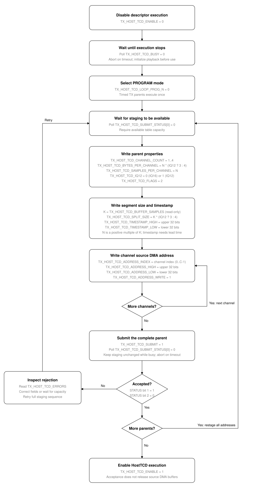

HostTCD TX software guide
=========================

HostTCD TX reads samples from separate host DMA buffers for channels A--D.
Each parent descriptor specifies the channel count, one source DMA address per
channel, the byte and sample counts per channel, the sample format and a shared
first-sample timestamp.

.. _host-tcd-tx-descriptor-table:

HostTCD TX Descriptor table
---------------------------

Software fills one parent at a time through the CSR staging window. For each
logical channel, select its index, write the DMA address high and low words,
then strobe ``ADDRESS_WRITE``. After staging all channels and the shared fields,
strobe ``SUBMIT``. The FPGA validates and copies the addresses before making
the complete parent visible to the DMA sequencer. Wait for acceptance before
changing staging registers; a successful submission clears the address
initialization mask, so every parent needs its addresses written again.

   HostTCD TX descriptor submission flow. The initial stop and program-mode
   selection apply when preparing a stopped stream; an initialized running
   stream can submit further parents starting at the staging-availability check.

   Editable source: :download:`draw.io diagram <images/HostTCD_TX_submission.drawio.svg>`.

The following algorithm assumes the streaming timed-TX table (version 3),
program mode (``LOOP_PROG_N = 0``), available table capacity and an initialized
TX playback path. Timed parents execute once; loop mode is unsupported.
``channel_count`` is 1 through 4. ``samples_per_channel`` is a positive multiple
of the read-only ``BUFFER_SAMPLES`` value (4096 in the current HiperSDR
configuration). IQ16 uses four bytes per complex sample; packed IQ12 uses
three. The resulting byte count must fit in 32 bits. ``SPLIT_SIZE`` must equal
one buffer's payload bytes per channel for the selected format.

``dma_addr`` contains driver-provided, 32-byte-aligned source DMA addresses,
not application pointers. Each mapping covers ``bytes_per_channel`` bytes
without wrapping the 64-bit address range. Synchronize source buffers for DMA
before submission and retain them until safe parent retirement.
``timestamp`` is the first sample's shared RX/TX tick, with sufficient lead
time for fetching and playback; late segments can be skipped.

Use ordered register accesses and the generated CSR addresses for the loaded
bitstream. Serialize the entire staging/submission sequence between producers.
``wait_for_clear()`` polls the specified bits and aborts the operation on timeout.

.. code-block:: c
   :caption: Algorithm: fill and submit one HostTCD TX parent descriptor
   :name: host-tcd-tx-fill-descriptor

   wait_for_clear(CSR_TX_HOST_TCD_SUBMIT_STATUS_ADDR, 1, timeout_ms);
   uint32_t buffer_samples = read32(CSR_TX_HOST_TCD_BUFFER_SAMPLES_ADDR);
   uint32_t bytes_per_sample = iq12 ? 3 : 4;
   /* Validate counts and 32-bit byte-count range before these writes. */
   uint32_t bytes_per_channel = samples_per_channel * bytes_per_sample;

   write32(CSR_TX_HOST_TCD_CHANNEL_COUNT_ADDR, channel_count);
   write32(CSR_TX_HOST_TCD_BYTES_PER_CHANNEL_ADDR, bytes_per_channel);
   write32(CSR_TX_HOST_TCD_SAMPLES_PER_CHANNEL_ADDR, samples_per_channel);
   write32(CSR_TX_HOST_TCD_IQ12_ADDR, iq12 ? 1 : 0);
   write32(CSR_TX_HOST_TCD_SPLIT_SIZE_ADDR, buffer_samples * bytes_per_sample);
   write32(CSR_TX_HOST_TCD_TIMESTAMP_HIGH_ADDR, (uint32_t)(timestamp >> 32));
   write32(CSR_TX_HOST_TCD_TIMESTAMP_LOW_ADDR, (uint32_t)timestamp);
   write32(CSR_TX_HOST_TCD_FLAGS_ADDR, 2); /* Disable early-last termination. */

   for (unsigned i = 0; i < channel_count; ++i) {
       write32(CSR_TX_HOST_TCD_ADDRESS_INDEX_ADDR, i);
       write32(CSR_TX_HOST_TCD_ADDRESS_HIGH_ADDR, (uint32_t)(dma_addr[i] >> 32));
       write32(CSR_TX_HOST_TCD_ADDRESS_LOW_ADDR, (uint32_t)dma_addr[i]);
       write32(CSR_TX_HOST_TCD_ADDRESS_WRITE_ADDR, 1);
   }

   write32(CSR_TX_HOST_TCD_SUBMIT_ADDR, 1);
   wait_for_clear(CSR_TX_HOST_TCD_SUBMIT_STATUS_ADDR, 1, timeout_ms);
   uint32_t status = read32(CSR_TX_HOST_TCD_SUBMIT_STATUS_ADDR);

   if (status & 4) {
       uint32_t errors = read32(CSR_TX_HOST_TCD_ERRORS_ADDR);
       /* Submission rejected: inspect errors, correct and retry. */
   } else if (status & 2) {
       /* Parent queued; fetching and playback retirement are still pending. */
   }

``SUBMIT_STATUS`` bit 0 means validation/copy busy, bit 1 means the last
submission was accepted and bit 2 means it was rejected. ``ERRORS`` provides
sticky diagnostics, including invalid fields, a full table, missing addresses
or staging writes while busy. Acceptance does not indicate DMA completion or
release the source buffers.

.. _host-tcd-tx-completion-record-fifo:

Completion record FIFO
----------------------

The streaming timed-TX path publishes one completion record after the final
segment outcome of a parent is collected. The record covers all participating
channels, including segments discarded because they were late and samples
skipped after a playback underrun. It reports playback/discard completion,
not descriptor acceptance or prefetch completion.

Each record contains eight 32-bit words (32 bytes). The result FIFO is configured
with depth 16 and a buffered output stage. The CSRs expose whether a record is
available, rather than a readable entry count. Obtain register addresses from
the loaded bitstream's generated CSR map; these registers belong to
``CSR_TX_TIMED_*``, while descriptor submission uses ``CSR_TX_HOST_TCD_*``.

Reading entries
~~~~~~~~~~~~~~~

Poll ``RECORD_AVAILABLE``, or check it after a TX parent interrupt. Descriptor
``FLAGS`` bit 0 suppresses that parent's interrupt but does not suppress its
completion record. ``wait_for_set()`` polls the specified bits and aborts the
operation on timeout.

.. code-block:: c
   :caption: Algorithm: read and pop HostTCD TX completion records
   :name: host-tcd-tx-read-completion

   while (read32(CSR_TX_TIMED_RECORD_AVAILABLE_ADDR) & 1) {
       uint32_t words[8];

       write32(CSR_TX_TIMED_RECORD_SNAPSHOT_ADDR, 1);
       wait_for_set(CSR_TX_TIMED_SNAPSHOT_VALID_ADDR, 1, timeout_ms);

       for (unsigned i = 0; i < 8; ++i) {
           words[i] = read32(CSR_TX_TIMED_RECORD_WORD0_ADDR + 4 * i);
       }

       uint32_t protocol_error = read32(CSR_TX_TIMED_PROTOCOL_ERROR_ADDR);
       write32(CSR_TX_TIMED_RECORD_POP_ADDR, 1);
       process_tx_record(words, protocol_error); /* Process the local copy. */
   }

Use ordered device register accesses and one consumer for the entire sequence.
Writing one to ``RECORD_SNAPSHOT`` copies the FIFO head into ``RECORD_WORD0``
through ``RECORD_WORD7`` and sets ``SNAPSHOT_VALID``. A request with no available
record captures nothing. The snapshot stays stable while new completions arrive;
reading a word does not advance the FIFO.

After copying all eight words, write one to ``RECORD_POP`` to remove the head
and clear ``SNAPSHOT_VALID``. Pop without a valid snapshot does nothing. Take
a new snapshot for every entry. A full result FIFO backpressures final parent
outcomes and can eventually stall TX buffer reuse and fetching; drain records
regularly even when parent interrupts are disabled.

Record fields
~~~~~~~~~~~~~

Word indices start at zero. Sample counts are complex samples per channel,
not the sum across channels. All participating channels share the same outcome.

.. list-table:: TX completion record fields
   :header-rows: 1
   :widths: 12 23 65

   * - Word(s)
     - Field
     - Description
   * - 0
     - ``sequence``
     - Parent execution sequence modulo 2^32. Starts at zero after a results/table reset and advances once per executed parent, including fully skipped parents.
   * - 1
     - ``requested``
     - Requested complex samples per channel, from the parent's ``samples_per_channel``.
   * - 2
     - ``transmitted``
     - Samples per channel accepted by the playback output across all segments; can include a partial segment before an underrun.
   * - 3
     - ``skipped``
     - Requested samples per channel that were not transmitted. Normally ``transmitted + skipped = requested``.
   * - 4
     - ``flags``
     - Bit 0: at least one late or deliberately skipped segment. Bit 1: playback underrun in at least one segment. Both can be set; other bits are zero.
   * - 5--6
     - ``timestamp``
     - Original first-sample timestamp of the parent, low word first. Reconstruct as ``(uint64_t)words[5] | ((uint64_t)words[6] << 32)``. This is the requested schedule, not an actual transmission or host-arrival timestamp.
   * - 7
     - ``chunks``
     - Total TX segments accounted for, including skipped segments. Expected value: ``requested / BUFFER_SAMPLES``.

Keep a software queue of accepted parents and match records by execution
sequence. The record does not contain source DMA addresses, channel count,
format or a software epoch. Preserve those values and track reset generations
in the driver. A rejected submission does not produce a completion record.

Validate the sequence, counts and flags before releasing a parent's source
buffers. ``PROTOCOL_ERROR`` is a separate sticky status bit indicating an
unexpected outcome sequence, a transmitted count larger than its segment, or
an aggregate sample count inconsistent with the parent. It is cleared with
the results state by an accepted table reset; popping a record does not clear
it. If set, treat completion accounting as unreliable and recover the stream
before relying on it for buffer ownership.

Completion counts summarize the parent; they do not locate individual gaps.
Use the driver's DMA ownership rules when recycling mappings. Reading
``TX_HOST_TCD_LEVEL`` or observing that fetching finished does not replace
playback completion tracking.
